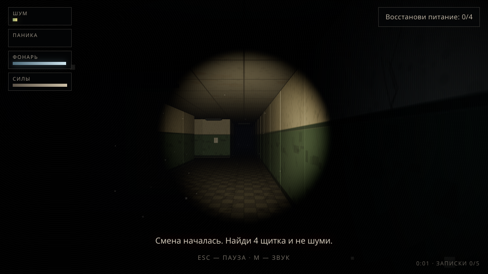

# Дежурная не ушла — 3D

Полноценный браузерный хоррор от первого лица. Ты заперт в ночной школе, свет выключен, а дежурная всё ещё ходит по коридорам. Восстанови четыре щитка и дойди до входной двери — пока она не нашла тебя.



## Что внутри

- **3D от первого лица** на Three.js: коридоры и кабинеты школьного корпуса, процедурные текстуры (линолеум, зелёная панель на стенах, потолочная плитка), экспоненциальный туман, мягкие тени от фонаря.
- **Фонарь с батарейкой**: ищется в темноте, садится, мигает на нуле. Батарейки разбросаны по школе.
- **Дежурная с ИИ**: патрулирует маршрут, **слышит** твой бег (радиус шума растёт с бегом), **видит** в конусе взгляда, а луч твоего фонаря выдаёт тебя издалека. Услышав — идёт на звук, увидев — преследует, потеряв след — обыскивает район.
- **Прятки в шкафчиках**: если она видела, как ты нырнул — откроет дверцу. Спасает **задержка дыхания (B)**: она «считает» твои шаги, но затаившесь ты рискуешь сорваться в громкий вдох.
- **4 щитка** чинятся удержанием Space (со шкалой прогресса). Каждый включённый щиток зажигает часть ламп в школе — свет возвращается постепенно. После четвёртого щитка она знает, что ты у двери.
- **Записки с лором (5 штук)** — про аварию 1987 года, график дежурств и то, кто теперь работает ночью.
- **Страшилки-события**: привидение в конце коридора, шёпот, отключения света, хлопки дверей, самопроизвольное мигание фонаря, ложные следы для дежурной.
- **Звук целиком процедурный** (WebAudio, без единого файла): низкий дрон, шаги, сердцебиение по панике, шёпот, гул дежурной рядом, напряжение при охоте, скример.
- **HUD**: шум, паника, заряд фонаря, силы (спринт), цель, субтитры, таймер и найденные записки. Красная виньетка при панике, тряска камеры, зерно и виньетка как в плёнке.
- **Полный цикл**: титульный экран, пауза (Esc), экран смерти с джампскейром и статистикой, экран победы.

## Запуск

Нужен любой статический сервер (игра — ES-модули, file:// не подойдёт):

```bash
python3 -m http.server 8000
# или
npm start
```

Открой `http://localhost:8000`.

## Управление

| Клавиша | Действие |
| --- | --- |
| **WASD** / стрелки | идти |
| **Мышь** | смотреть (захват курсора при старте; при отказе — зажать ЛКМ) |
| **Shift** | бежать — быстро, но очень громко |
| **C** / **Ctrl** | красться — тихо и низко |
| **F** | фонарь вкл/выкл |
| **Space** (удерживать) | чинить щиток |
| **E** | спрятаться / выйти / прочитать записку / открыть дверь |
| **B** (удерживать) | задержать дыхание в шкафчике |
| **Esc** | пауза |
| **M** | звук вкл/выкл |
| **Enter** | рестарт после смерти/победы |

## Советы

- Бег слышен через полшколы — беги только когда уверена, что она далеко.
- Выключай фонарь в коридорах: свет выдаёт тебя раньше, чем ты её увидишь.
- Если она уже идёт к шкафчику — задержи дыхание и надейся, что память кончится раньше, чем у тебя воздух.
- После четвёртого щитка — не исследуй, просто беги к входу.

## Технологии

- **Three.js r160** (лежит в `lib/`, внешних CDN нет — работает офлайн).
- Все текстуры — процедурные (Canvas 2D), весь звук — WebAudio-синтез, графика людей — примитивы. Никаких внешних ассетов, кроме двух картинок экранов в `assets/`.
- Карта, маршрут патруля и расстановка щитков унаследованы из оригинальной 2D-версии.
- Исходники: `src/main.js` (состояние, игрок, события), `src/world.js` (карта, геометрия, поиск пути), `src/enemy.js` (ИИ и модель дежурной), `src/audio.js` (звук).

## Отладка

В консоли браузера доступен `window.__lh` — телепорт (`__lh.teleport(x, y)` по клеткам карты), `__lh.fixAll()`, `__lh.kill()`, `__lh.win()` и состояние игрока.
